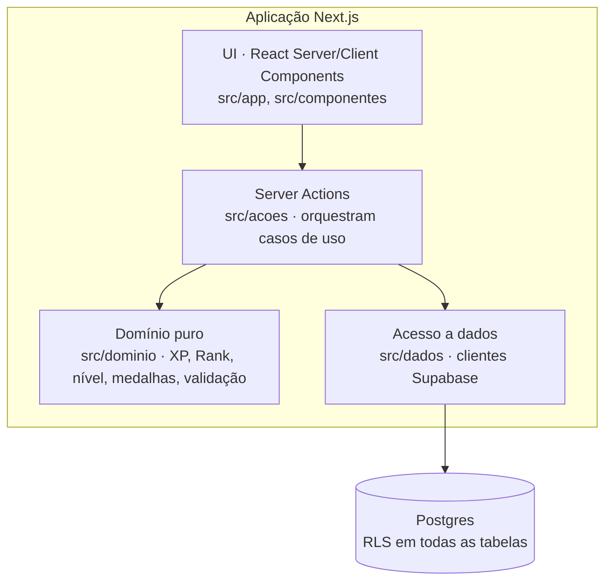
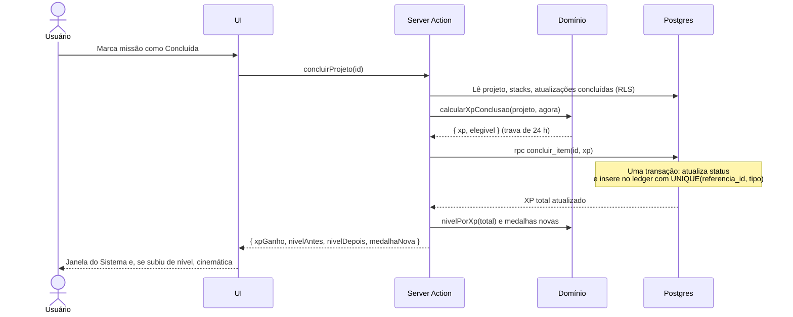
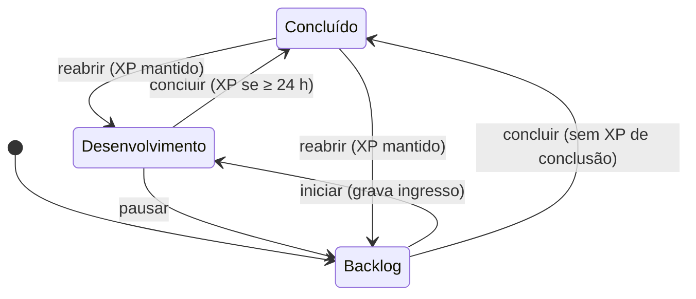

# Arquitetura

> Decisões e alternativas descartadas em [`adr/`](adr/). Diagramas em Mermaid: renderizam no GitHub e no VS Code (extensão *Markdown Preview Mermaid Support*).

## 1. Estilo

**Monolito modular em Next.js (App Router).** Um usuário, um deploy. Microsserviços seriam custo sem benefício (ADR-0001). Dentro do monolito, a regra de negócio fica isolada do framework.

## 2. Contexto (C4 nível 1)

## 3. Contêineres e camadas (C4 nível 2)

| Camada | Responsabilidade | Pode depender de |
|---|---|---|
| `src/app`, `src/componentes` | Renderizar e capturar intenção do usuário | `acoes`, tipos do `dominio` |
| `src/acoes` | Validar entrada (Zod), orquestrar, tratar erro de fronteira, logar | `dominio`, `dados` |
| `src/dominio` | Regras de negócio puras e determinísticas | nada (sem Next, sem Supabase) |
| `src/dados` | Ler e gravar no Postgres com a sessão do usuário | Supabase SDK |

O domínio não importa nada de infraestrutura: é testável em milissegundos e sobrevive a uma troca de banco ou framework.

## 4. Fluxo crítico: concluir missão

**Por que a função SQL:** o cliente Supabase não abre transação. Atualizar o status e gravar o XP em duas chamadas permite um estado inconsistente (missão concluída sem XP) se a segunda falhar (ADR-0003).

## 5. Ciclo de vida do status

Vale para Projetos. Atualizações seguem o mesmo ciclo, sem a trava de 24 h.

## 6. Segurança

- **Autenticação:** GitHub OAuth via Supabase Auth, com cadastro público desativado (ADR-0004).
- **Autorização em três camadas:** cadastro fechado no provedor → allowlist de IDs do GitHub no middleware → RLS `user_id = auth.uid()` no banco.
- **Menor privilégio:** a aplicação não usa a `service_role`; toda consulta roda com a sessão do usuário.
- **Segredos:** apenas em variáveis de ambiente, validadas na inicialização (`src/lib/ambiente.ts`), com mensagem de erro que lista nomes de campos, nunca valores.
- **Repositório público:** `gitleaks` no CI, push protection do GitHub, dados fictícios no seed.
- **Cabeçalhos HTTP** (`next.config.ts`): `X-Frame-Options: DENY`, `X-Content-Type-Options`, `Referrer-Policy`, `Permissions-Policy` e HSTS.
- **CSP com nonce** (`src/proxy.ts` + `src/lib/seguranca/csp.ts`): nonce de 128 bits novo a cada requisição, `script-src` com `'strict-dynamic'`, `connect-src` restrito à origem do Supabase, sem `'unsafe-inline'` em scripts. Exige render por requisição ([ADR-0007](adr/0007-csp-nonce-render-por-requisicao.md)).
- **Cadeia de suprimentos:** Actions fixadas por SHA de commit; Dependabot semanal para npm e Actions; o CI bloqueia vulnerabilidade `high` ou maior em dependência de **produção**. O gitleaks roda pela CLI com versão fixada e checksum SHA-256 conferido no próprio workflow; essa versão **não** é atualizada pelo Dependabot e deve ser revisada a cada release.

### Riscos aceitos
| Data | Risco | Por que é aceito | Revisão |
|---|---|---|---|
| 2026-10-21 | [GHSA-vfj7-8cjw-p6xm](https://github.com/advisories/GHSA-vfj7-8cjw-p6xm): `braces` ≤ 3.0.3 (DoS por padrão de glob aninhado), via `eslint-config-next` → `fast-glob` → `micromatch`. Sem versão corrigida publicada. | Dependência só de desenvolvimento. Os padrões de glob vêm da configuração do ESLint do próprio projeto, nunca de entrada externa. O audit de produção está limpo. | Fechar quando o Dependabot propuser a versão corrigida. |

## 7. Notas de framework

- **Next.js 16 com `cacheComponents` ligado e app inteiro dinâmico:** o layout raiz declara `instant = false` e chama `await connection()` ([ADR-0007](adr/0007-csp-nonce-render-por-requisicao.md)). Por isso, ler cookies ou sessão não exige `<Suspense>`. `<Suspense>` continua útil para mostrar o estado de carregamento enquanto um dado lento chega.
- **Sessão renovada no proxy:** `src/lib/supabase/sessao-proxy.ts` chama `getClaims()` a cada requisição e devolve os cookies renovados com os cabeçalhos anti-cache do `@supabase/ssr`. Nunca usar `getSession()` no servidor: ele confia no cookie sem validar a assinatura.
- **Tipos de rota gerados:** `npm run typecheck` executa `next typegen` antes do `tsc`, porque tipos como `LayoutProps` só existem depois da geração.

## 8. Observabilidade

Log estruturado em JSON nas Server Actions, sem dado pessoal · error boundary por rota · logs da Vercel. Sentry fica fora da v1 (um usuário só).
