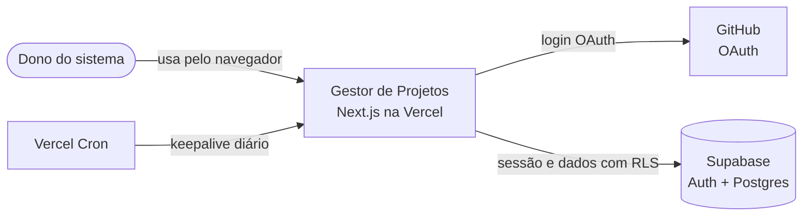
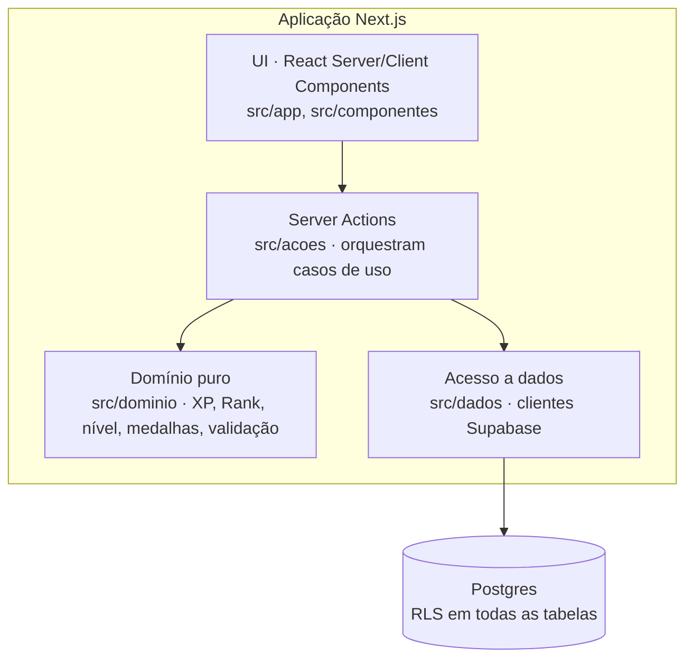
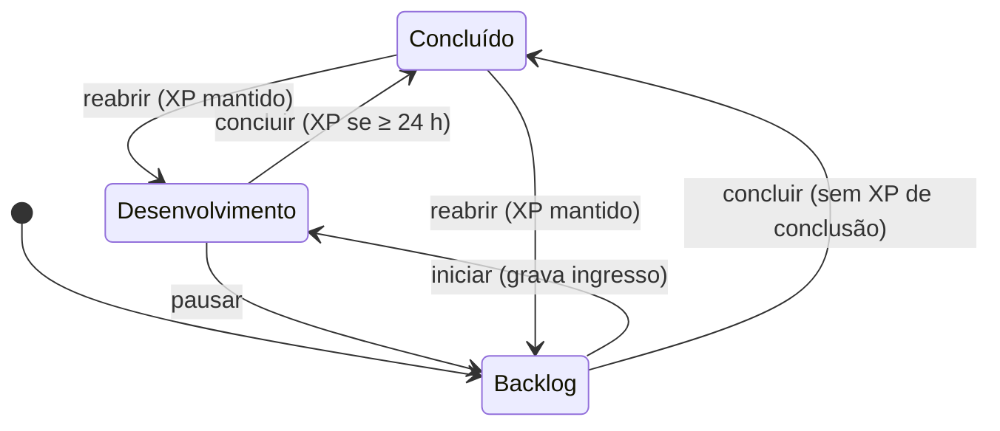

# Arquitetura

> Decisões e alternativas descartadas em [`adr/`](adr/). Diagramas em Mermaid: renderizam no GitHub e no VS Code (extensão *Markdown Preview Mermaid Support*).

## 1. Estilo

**Monolito modular em Next.js (App Router).** Um usuário, um deploy. Microsserviços seriam custo sem benefício (ADR-0001). Dentro do monolito, a regra de negócio fica isolada do framework.

## 2. Contexto (C4 nível 1)



## 3. Contêineres e camadas (C4 nível 2)



| Camada | Responsabilidade | Pode depender de |
|---|---|---|
| `src/app`, `src/componentes` | Renderizar e capturar intenção do usuário | `acoes`, tipos do `dominio` |
| `src/acoes` | Validar entrada (Zod), orquestrar, tratar erro de fronteira, logar | `dominio`, `dados` |
| `src/dominio` | Regras de negócio puras e determinísticas | nada (sem Next, sem Supabase) |
| `src/dados` | Ler e gravar no Postgres com a sessão do usuário | Supabase SDK |

O domínio não importa nada de infraestrutura: é testável em milissegundos e sobrevive a uma troca de banco ou framework.

## 4. Fluxo crítico: concluir missão

```mermaid
sequenceDiagram
    actor U as Usuário
    participant UI as UI
    participant A as Server Action
    participant D as Domínio
    participant DB as Postgres

    U->>UI: Move o Projeto para Concluído (Quadro ou ficha)
    UI->>A: moverMissao(id, 'concluido')
    A->>DB: Lê o Projeto, as Atualizações concluídas e se já houve XP de conclusão (RLS)
    A->>D: avaliarConclusaoProjeto(...)
    D-->>A: { xp } ou o motivo: trava de 24 h ou XP já recebido
    A->>DB: rpc mudar_status_missao(id, status, xp, rank)
    Note over DB: Uma transação: atualiza o status e insere no ledger<br/>com UNIQUE(user_id, referencia_id, tipo), snapshots e trilha
    DB-->>A: { situacao, xp_ganho }
    A-->>UI: { ok, recompensa }
    UI-->>U: Aviso (+XP, trava ou já recebido); o HUD soma o ledger de novo
```

Criar Projeto ou Atualização segue o mesmo desenho (`salvar_missao_v4`, `criar_atualizacao`). Excluir revoga o XP de criação por trigger, inclusive na cascata (ADR-0011). Depois de dar XP, a ação guarda o nível de Desenvolvedor em `personagem.nivel_maximo` pela `registrar_nivel_maximo` (M4), que só aumenta o valor; uma falha ali só vai para o log, porque a tela usa o maior entre o máximo e o nível atual.

A cinemática de level up (M5) não depende de a ação devolver "subiu": o HUD, renderizado de novo depois de toda ação que dá XP (inclusive a criação, que termina em redirect), compara o nível conquistado com `personagem.nivel_visto`. Ao fechar a cinemática, a Server Action `marcarConquistaVista` sincroniza o `nivel_maximo` e grava o visto pela `marcar_conquista_vista`. No navegador, o `ProvedorSistema` (layout do jogo) mostra uma janela de cada vez: a ação de mudar status reserva a fila antes de chamar o servidor, e a Janela do Sistema da conclusão abre e fecha antes da cinemática.

**Por que a função SQL:** o cliente Supabase não abre transação. Atualizar o status e gravar o XP em duas chamadas permite um estado inconsistente (missão concluída sem XP) se a segunda falhar (ADR-0003).

## 5. Ciclo de vida do status



Vale para Projetos. Atualizações seguem o mesmo ciclo, sem a trava de 24 h.

## 6. Segurança

- **Autenticação:** GitHub OAuth via Supabase Auth, com cadastro público desativado (ADR-0004).
- **Autorização em três camadas:** cadastro fechado no provedor → allowlist de IDs do GitHub no retorno do OAuth (`/auth/callback`, a partir do `provider_id` da identidade, nunca do `user_metadata`) → RLS `user_id = auth.uid()` no banco. Fora da allowlist, a sessão recém-criada é encerrada antes de qualquer página.
- **Proxy como primeiro portão:** sem sessão válida (`getClaims()`), toda rota redireciona para `/entrar`; rota nova nasce protegida (`src/dominio/acesso/rotas.ts`). Server Actions e Route Handlers conferem a sessão de novo, e o RLS protege os dados mesmo se o proxy falhar.
- **Login por e-mail desligado** (`[auth.email] enable_signup = false` desliga o provedor inteiro); só o GitHub autentica.
- **Logs** em JSON (`src/lib/log.ts`), só com valores primitivos e sem dado pessoal: registram a causa técnica de uma recusa, nunca e-mail, nome ou ID.
- **Menor privilégio:** a aplicação não usa a `service_role`; toda consulta roda com a sessão do usuário. Objetos novos no schema `public` nascem sem privilégio para `anon`, `authenticated` e `service_role` (migration `revogar_exposicao_padrao`); cada migration concede o necessário.
- **Deploy só pelo GitHub Actions** ([ADR-0008](adr/0008-deploy-pelo-github-actions.md)): aprovação obrigatória no ambiente `production`, segredos restritos ao projeto e entregues só aos passos que os usam, smoke test e rollback. Operação em [`operacao.md`](operacao.md).
- **Segredos:** apenas em variáveis de ambiente, validadas na inicialização (`src/lib/ambiente.ts`), com mensagem de erro que lista nomes de campos, nunca valores.
- **Repositório público:** `gitleaks` no CI, push protection do GitHub, só dados fictícios nos testes.
- **Banco testado no CI** (job `banco`): a cada PR, um Supabase descartável aplica as migrations do zero, roda os testes pgTAP e os advisors (`npm run db:advisors`), que falham em achado `WARN` ou `ERROR`. Achados `INFO` aparecem no log sem reprovar: num banco recém-criado, todo índice é acusado como "não usado" (falso positivo).
- **Cabeçalhos HTTP** (`next.config.ts`): `X-Frame-Options: DENY`, `X-Content-Type-Options`, `Referrer-Policy`, `Permissions-Policy` e HSTS.
- **CSP com nonce** (`src/proxy.ts` + `src/lib/seguranca/csp.ts`): nonce de 128 bits novo a cada requisição, `script-src` com `'strict-dynamic'`, `connect-src` restrito à origem do Supabase, sem `'unsafe-inline'` em scripts; o único atributo `style` aceito é o `display:none` que o React usa ao transmitir trechos de SVG (hash). Exige render por requisição ([ADR-0007](adr/0007-csp-nonce-render-por-requisicao.md)).
- **Cadeia de suprimentos:** Actions fixadas por SHA de commit; Dependabot semanal para npm e Actions; o CI bloqueia vulnerabilidade `high` ou maior em dependência de **produção**. O gitleaks roda pela CLI com versão fixada e checksum SHA-256 conferido no próprio workflow; essa versão **não** é atualizada pelo Dependabot e deve ser revisada a cada release.

### Riscos aceitos
| Data | Risco | Por que é aceito | Revisão |
|---|---|---|---|
| 2026-10-21 | [GHSA-vfj7-8cjw-p6xm](https://github.com/advisories/GHSA-vfj7-8cjw-p6xm): `braces` ≤ 3.0.3 (DoS por padrão de glob aninhado), via `eslint-config-next` → `fast-glob` → `micromatch`. Sem versão corrigida publicada. | Dependência só de desenvolvimento. Os padrões de glob vêm da configuração do ESLint do próprio projeto, nunca de entrada externa. O audit de produção está limpo. | Fechar quando o Dependabot propuser a versão corrigida. |

## 7. Notas de framework

- **Next.js 16 com `cacheComponents` ligado e app inteiro dinâmico:** o layout raiz declara `instant = false` e chama `await connection()` ([ADR-0007](adr/0007-csp-nonce-render-por-requisicao.md)). Por isso, ler cookies ou sessão não exige `<Suspense>`. `<Suspense>` continua útil para mostrar o estado de carregamento enquanto um dado lento chega.
- **Server Components que consultam o Supabase chamam `await connection()` antes:** o `partialPrefetching` pré-renderiza em tempo de execução, com cookies, mas proíbe `Date.now()`, que o supabase-js usa ao ler a sessão. Sem isso, a consulta é abortada nessa passagem e gera um erro falso no log (exemplo: `app/(jogo)/hud.tsx`).
- **Health check `GET /api/saude`:** `200 {"status":"ok"}` ou `503 {"status":"indisponivel"}`, sempre com `Cache-Control: no-store` e sem nenhum detalhe na resposta (a causa vai só para o log). Prova que o banco responde chamando a função `verificar_saude()` (retorna `true`, não lê tabela, executável só por `anon`), com limite de 3 s: um banco travado vira 503 em vez de prender o smoke test.
- **Export JSON `GET /api/exportar` (RF-14):** exige sessão (o proxy redireciona quem não tem; a rota confere de novo e responde `401`). Devolve o arquivo com `Content-Disposition: attachment` e `Cache-Control: no-store`, ou `500 {"erro":"falha-ao-exportar"}`. O log leva contagens, bytes e o código do banco, nunca o conteúdo. A lógica fica em `app/api/exportar/responder.ts`, testável com um cliente falso.
- **Ambiente validado na subida** (`src/instrumentation.ts`): com variável faltando, o log mostra o nome do campo (nunca o valor) e toda requisição, inclusive `/api/saude`, responde 500. O servidor não encerra o processo (o Next não oferece isso na instrumentação), mas o smoke test com `curl -f` falha e o deploy é revertido. A instrumentação não roda no build, então o CI não precisa do `.env`.
- **Validade máxima da sessão: 12 horas desde o login** (`dominio/acesso/sessao.ts`), contada pelo `amr[].timestamp` do JWT validado. O proxy encerra a sessão vencida (revoga o refresh token, `scope: local`) e manda para `/entrar?erro=sessao-expirada`. O Supabase só oferece esse limite no plano Pro.
- **Sessão renovada no proxy:** `src/lib/supabase/sessao-proxy.ts` chama `getClaims()` a cada requisição e devolve os cookies renovados com os cabeçalhos anti-cache do `@supabase/ssr`. Nunca usar `getSession()` no servidor: ele confia no cookie sem validar a assinatura.
- **Tipos de rota gerados:** `npm run typecheck` executa `next typegen` antes do `tsc`, porque tipos como `LayoutProps` só existem depois da geração.

## 8. Observabilidade

Log estruturado em JSON nas Server Actions, sem dado pessoal · error boundary por rota · logs da Vercel. Sentry fica fora da v1 (um usuário só).
