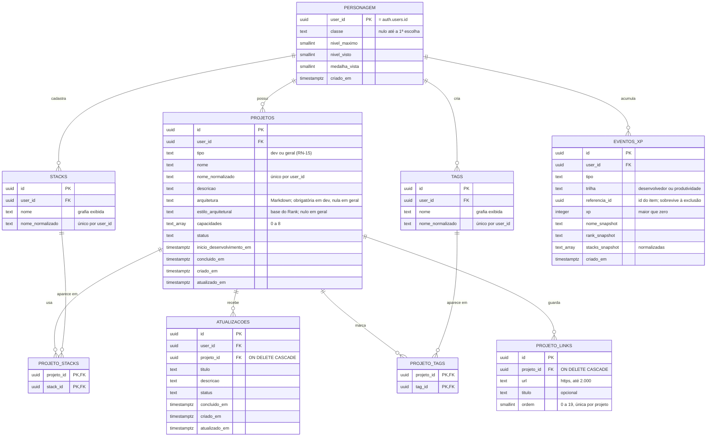

# Modelo de dados

> **Estado:** migrations versionadas em `supabase/migrations/`. Implementado: `personagem` (M1a), `projetos`, `stacks`, `projeto_stacks`, o trigger de datas (M1b); `estilo_arquitetural`, `capacidades` e a função `salvar_missao_v2` (M1c). A `dificuldade` e a `salvar_missao` do M1b saíram na migration `contrair_dificuldade`; `atualizacoes` (M2); `projetos.tipo`, `tags`, `projeto_tags`, `projeto_links` e a função `salvar_missao_v3` (requisitos 1.4, migration `tipos_tags_links`); a `salvar_missao_v2` e o padrão de `estilo_arquitetural` saíram na migration `contrair_tipos`; a função `renomear_tag` e a exclusão de tag sem uso (requisitos 1.5, migration `renomear_tags`); `eventos_xp`, o trigger de revogação e as funções `salvar_missao_v4`, `criar_atualizacao`, `mudar_status_missao`, `mudar_status_atualizacao` e `resumo_xp` (M3, migration `criar_eventos_xp`). A `salvar_missao_v3` saiu na migration `contrair_salvar_missao_v3`. A função `exportar_dados` (M6, migration `exportar_dados`).
>
> Modelo **transacional normalizado (3FN)**: o sistema grava e consulta registros individuais; não há camada analítica separada.

## 1. Diagrama entidade-relacionamento

## 2. Dicionário de dados

### `personagem` — grão: 1 linha por usuário
| Coluna | Tipo | Regra |
|---|---|---|
| `user_id` | `uuid` PK | = `auth.users.id`, `ON DELETE CASCADE` |
| `classe` | `text` | `CHECK` nas 8 chaves de `requisitos.md` §6; nulo até a escolha (RF-17) |
| `nivel_maximo` | `smallint` | 1–100; nunca diminui (medalhas permanentes, RN-08) |
| `nivel_visto` | `smallint` | 1–100, padrão 1; último nível cuja cinemática já tocou (M5, RF-16). Só aumenta e não passa do `nivel_maximo`. Na migration, as linhas existentes começaram com o `nivel_maximo` (sem cinemática retroativa) |
| `medalha_vista` | `smallint` | 0–10; última medalha cuja animação já tocou; acompanha o `nivel_visto` (`nivel_visto / 10`) |
| `criado_em` | `timestamptz` | `default now()` |

**Privilégios** (migration `criar_personagem`): `authenticated` lê a linha, cria só com `user_id` (o resto vem dos defaults) e altera só `classe` e `medalha_vista`. `nivel_maximo` fica fora do `UPDATE`: só a função `registrar_nivel_maximo` (M4, `SECURITY DEFINER`, `search_path` vazio, filtro `auth.uid()`) grava esse campo, e grava `greatest(atual, novo)`, então ninguém baixa o próprio nível pela API. Risco aceito, como o `p_xp` (ADR-0003): o dono pode subi-lo chamando a função. `nivel_visto` segue o mesmo desenho (M5): fica fora do `UPDATE` e só a `marcar_conquista_vista(p_nivel)` (`SECURITY DEFINER`, `search_path` vazio, filtro `auth.uid()`) o grava, com `greatest(atual, least(p_nivel, nivel_maximo))`, junto com a `medalha_vista`. Com `UPDATE` na coluna, o usuário também baixaria o valor e a cinemática repetiria. Não há `DELETE`: a linha sai com o usuário (`ON DELETE CASCADE`). `anon` não tem nenhum privilégio.

### `projetos` — grão: 1 linha por Projeto
| Coluna | Tipo | Regra |
|---|---|---|
| `id` | `uuid` PK | `gen_random_uuid()` |
| `user_id` | `uuid` FK | dono; base do RLS |
| `nome` | `text` | 3–80 caracteres |
| `nome_normalizado` | `text` | `lower(trim(nome))`; `UNIQUE (user_id, nome_normalizado)` |
| `tipo` | `text` | `NOT NULL DEFAULT 'dev'`; `CHECK (tipo IN ('dev','geral'))` (RN-15, ADR-0010) |
| `descricao` | `text` | 1–2.000 |
| `arquitetura` | `text` | nula em `geral`; em `dev`, 1–20.000 e não só espaços (`CHECK`) |
| `estilo_arquitetural` | `text` | nulo em `geral`; `CHECK` nos 7 estilos da RN-14. Sem `DEFAULT`: a Missão `dev` informa o estilo |
| `capacidades` | `text[]` | `NOT NULL DEFAULT '{}'`; `CHECK` de subconjunto das 8 capacidades e no máximo 8 itens. A repetição não é barrada no `CHECK` (sem subconsulta): a função grava sem repetir e o domínio conta capacidades distintas |
| `status` | `text` | `CHECK (status IN ('backlog','desenvolvimento','concluido'))` |
| `inicio_desenvolvimento_em` | `timestamptz` | ingresso mais recente em Desenvolvimento (trava de 24 h) |
| `concluido_em` | `timestamptz` | preenchido só em `concluido` (`CHECK` de coerência) |
| `criado_em`, `atualizado_em` | `timestamptz` | automáticos |
| — | | `CHECK projetos_campos_por_tipo`: `dev` exige estilo e arquitetura; `geral` os exige nulos e `capacidades = '{}'` |

**Datas de status (RN-02):** um trigger `BEFORE INSERT OR UPDATE` grava `inicio_desenvolvimento_em` ao entrar em Desenvolvimento, `concluido_em` ao entrar em Concluído (e o apaga ao sair) e `atualizado_em` em toda edição. Essas colunas ficam fora dos `GRANT`s de escrita: só o trigger as grava.

**Privilégios** (migrations `criar_missoes` e `tipos_tags_links`): `authenticated` lê e apaga as próprias Missões e cria ou altera só `tipo`, `nome`, `descricao`, `arquitetura`, `estilo_arquitetural`, `capacidades` e `status`; `user_id` vem do default `auth.uid()`, nunca do cliente. `anon` não tem nenhum privilégio. Objetos novos no `public` nascem sem acesso (migration `revogar_exposicao_padrao`).

O Rank do Projeto **não é coluna**: o domínio o deriva de `estilo_arquitetural`, `capacidades` e da contagem de stacks (RN-14), e só em `dev`. Guardá-lo criaria duas fontes da verdade.

**Gravação:** `salvar_missao_v4` grava a Missão, as stacks (ou ferramentas), as tags, os links, os vínculos e, na criação, o XP de criação numa transação; na edição, **não altera o status**. A mudança de status (Quadro, RF-20, e ficha) passa pela `mudar_status_missao`, que altera só `status` e grava o XP de conclusão, e não mexe na "última edição" quando o status não muda. As trocas da `salvar_missao` pela v2, da v2 pela v3 e da v3 pela v4 foram feitas em dois deploys cada (expandir e depois contrair, `docs/operacao.md` §4); a v2 saiu na migration `contrair_tipos` e a v3 na `contrair_salvar_missao_v3`.

### `stacks` — grão: 1 linha por stack distinta do usuário
| Coluna | Tipo | Regra |
|---|---|---|
| `id` | `uuid` PK | |
| `user_id` | `uuid` FK | |
| `nome` | `text` | primeira grafia cadastrada (RN-05); 1–40 caracteres |
| `nome_normalizado` | `text` | `UNIQUE (user_id, nome_normalizado)` |

Tabela própria, e não array no projeto: permite autocompletar (evita "Next.js" e "NextJS" coexistirem) e contar uso por stack.

### `projeto_stacks` — grão: 1 linha por par (Projeto, stack)
PK composta `(projeto_id, stack_id)`. Ambas as FKs com `ON DELETE CASCADE`. O RLS só aceita ligar uma Missão do usuário a uma stack do mesmo usuário.

### `tags` — grão: 1 linha por tag distinta do usuário
Espelho de `stacks`: `nome` com 1–30 caracteres (primeira grafia, RN-05, até o dono renomear, RN-19), `nome_normalizado` com `UNIQUE (user_id, nome_normalizado)`. RLS: o dono lê, cria, altera e exclui só a tag **sem uso** (policy com `not exists` em `projeto_tags`: o delete de tag em uso afeta 0 linhas, sem erro). Privilégios (migrations `tipos_tags_links` e `renomear_tags`): `authenticated` insere e altera só `nome` e exclui; `user_id` vem da sessão, nunca do cliente.

### `projeto_tags` — grão: 1 linha por par (Projeto, tag)
PK composta `(projeto_id, tag_id)`, as duas FKs com `ON DELETE CASCADE` e índice por `tag_id` (filtro e cascata). O RLS só aceita ligar uma Missão do usuário a uma tag do mesmo usuário.

### `projeto_links` — grão: 1 linha por link de uma Missão
| Coluna | Tipo | Regra |
|---|---|---|
| `id` | `uuid` PK | |
| `projeto_id` | `uuid` FK | `ON DELETE CASCADE`; o RLS exige a Missão do usuário |
| `url` | `text` | até 2.000; `CHECK` de `https://` sem usuário ou senha antes do domínio (segunda barreira da RN-17) |
| `titulo` | `text` | opcional; até 80 e não só espaços |
| `ordem` | `smallint` | 0–19, posição na tela; `UNIQUE (projeto_id, ordem)` |

Os links não são alterados, só trocados inteiros pela função de gravação. O servidor nunca busca o endereço (sem risco de SSRF).

### Função `salvar_missao_v4`
Cria (`p_id` nulo) ou altera uma Missão com tipo, stacks ou ferramentas, tags e links, **numa transação** (ADR-0003). Em `geral`, descarta estilo, capacidades e arquitetura (RN-16). Insere stacks e tags novas (`on conflict do nothing`, mantendo a primeira grafia), substitui os vínculos e regrava os links com `ordem` 0, 1, …. Na edição, ignora `p_status`; no cadastro, o exige. Na criação, grava em `eventos_xp` o XP de `p_xp_criacao`, calculado pelo domínio (RN-06), na trilha do tipo; com `p_xp_criacao` nulo, não grava evento. `SECURITY INVOKER`: roda com a sessão de quem chama, sob o RLS. Erros: `23505` nome repetido · `23514` campo fora da regra · `22023` arquitetura vazia, status inicial ausente ou quantidade fora do limite (stacks 1–20 em `dev` e 0–20 em `geral`, tags 0–10, links 0–20) · `P0002` Missão inexistente ou de outro usuário.

### Função `renomear_tag`
Renomeia uma tag do usuário (`p_id`) para `p_nome` (sem espaços nas pontas). Se o nome novo já é de outra tag do usuário (comparação da RN-05), devolve o conflito sem mudar nada; com `p_juntar`, **numa transação**, passa os vínculos para a tag existente (`on conflict do nothing` descarta o vínculo repetido), dá a ela a grafia digitada e exclui a tag renomeada (RN-19). Devolve uma linha `(resultado, projetos, destino)`: `resultado` é `renomeada`, `conflito` ou `juntada`; `projetos`, quantas Missões tinham a tag; `destino`, a grafia final (no conflito, a da tag existente). Trava as duas tags com `for update`. `SECURITY INVOKER`, sob o RLS. Erros: `P0002` tag inexistente ou de outro usuário · `23514` nome fora da regra (CHECK da tabela).

### Função `exportar_dados`
Devolve todos os dados do usuário logado num único `jsonb` (RF-14): `personagem` (objeto ou nulo) e uma lista por tabela (`projetos`, `stacks`, `projeto_stacks`, `tags`, `projeto_tags`, `projeto_links`, `atualizacoes`, `eventos_xp`), em ordem de criação. Cada linha sai inteira, menos `user_id` e `nome_normalizado` (gerada). Um valor só, e não uma consulta por tabela, porque a Data API corta cada consulta em `max_rows` (1.000), e porque um único comando lê uma foto consistente. `SECURITY INVOKER`, `search_path` vazio, executável só por `authenticated`; o filtro por `auth.uid()` repete o RLS. O pgTAP (`exportar_dados.test.sql`) prende as chaves de cada tabela: coluna nova muda o formato do arquivo (`versao_formato`) e precisa de decisão.

### `atualizacoes` — grão: 1 linha por Atualização
| Coluna | Tipo | Regra |
|---|---|---|
| `id` | `uuid` PK | `gen_random_uuid()` |
| `user_id` | `uuid` FK | dono; base do RLS |
| `projeto_id` | `uuid` FK | obrigatório; `ON DELETE CASCADE` (RN-04) |
| `titulo` | `text` | 3–120, sem espaços nas pontas |
| `descricao` | `text` | até 5.000, não só espaços |
| `status` | `text` | `CHECK` nos 3 status; padrão `backlog` |
| `concluido_em` | `timestamptz` | preenchido só em `concluido` (`CHECK` de coerência) |
| `criado_em`, `atualizado_em` | `timestamptz` | automáticos; o histórico (RF-09) ordena por `criado_em` |

**Datas:** o trigger `registrar_datas_da_atualizacao` grava `concluido_em` ao entrar em Concluído (e o apaga ao sair) e `atualizado_em` em toda edição. Não há data de ingresso em Desenvolvimento: a trava de 24 h é só do Projeto.

**Privilégios e RLS** (migration `criar_atualizacoes`): `authenticated` lê e apaga as próprias e cria ou altera só `projeto_id`, `titulo`, `descricao` e `status`. As políticas de `INSERT` e `UPDATE` também exigem que a Missão de `projeto_id` seja do usuário (RN-01): sem isso, alguém penduraria uma Atualização na Missão de outro. Índices: `(projeto_id, criado_em desc)` para o histórico e `(user_id, status, criado_em desc)` para a página geral.

### `eventos_xp` — grão: 1 linha por evento de XP de um item
| Coluna | Tipo | Regra |
|---|---|---|
| `tipo` | `text` | `criacao_projeto` · `criacao_atualizacao` · `conclusao_projeto` · `conclusao_atualizacao` |
| `trilha` | `text` | `desenvolvedor` · `produtividade`, pelo tipo do Projeto no momento do evento; trocar o tipo depois não move o XP (RN-16, RN-18) |
| `referencia_id` | `uuid` | id do Projeto ou Atualização. **Sem FK**: o evento precisa sobreviver à exclusão do item |
| `xp` | `integer` | `CHECK (xp > 0)` |
| `nome_snapshot` | `text` | nome do item no momento do evento (Registro de Projetos) |
| `rank_snapshot` | `text` | Rank do Projeto na conclusão; nulo na trilha Produtividade e na criação |
| `stacks_snapshot` | `text[]` | stacks ou ferramentas normalizadas, só na conclusão do Projeto (base da Maestria e do Domínio, função `maestria()`) |
| — | | `UNIQUE (user_id, referencia_id, tipo)`: garante RN-06a no banco; o dono na chave impede que um usuário ocupe o par de outro |

**Append-only** (ADR-0011): o RLS deixa o dono ler; inserir só para item próprio; apagar só o evento de criação de item já excluído. Não há `UPDATE`. As funções gravam o item e o evento numa transação, com o XP calculado no domínio (ADR-0003). A única remoção é a revogação do XP de criação (RN-06c), feita pelo trigger `revogar_xp_de_criacao` (`AFTER DELETE` em `projetos` e `atualizacoes`), que vale também na cascata. Índice `(user_id, trilha) include (xp)` para a soma do HUD.

## 3. Segurança no banco

- RLS habilitado em **todas** as tabelas, com política `user_id = auth.uid()` para cada operação permitida.
- A aplicação usa a sessão do usuário (publishable key + JWT), nunca a `service_role`.
- Privilégios explícitos e por coluna (`GRANT`), porque a Data API não expõe tabelas novas automaticamente e o RLS filtra linhas, não colunas.
- Testes de banco em pgTAP (`supabase/tests/database/`, `npm run db:test`) provam que um usuário B não lê nem altera dados de um usuário A. Rodam no CI (job `banco`) a cada PR, junto com os advisors.

## 4. Consultas derivadas e grão

| Consulta | Fonte | Atenção ao grão |
|---|---|---|
| XP total por trilha | `resumo_xp()`: `SUM(xp)` em `eventos_xp` do usuário, por `trilha` | Grão do evento: sem JOIN, sem risco de duplicação |
| Nível, título, Rank do Aventureiro | XP total + domínio | Calculado, não armazenado (exceto `nivel_maximo`) |
| Maestria e Domínio | `maestria()` (M5, `SECURITY INVOKER`, sob o RLS): `unnest` distinto de `stacks_snapshot` em eventos `conclusao_projeto`, agrupado por trilha e stack; nome exibido pelo `LEFT JOIN` com `stacks` (1:1 por `user_id` + `nome_normalizado`), ou a grafia do snapshot | Grão: trilha + stack. O XP de um Projeto é replicado para cada stack **por definição** (ver `gamificacao.md` §5). A soma entre stacks não é o XP total. O `distinct` impede que uma stack repetida no mesmo snapshot conte duas vezes |
| Registro de Projetos | `eventos_xp` ordenado por `criado_em` | Usa os snapshots; continua legível após exclusões |
| Export JSON (RF-14) | `exportar_dados()`: um `jsonb_agg` por tabela, sem JOIN entre elas | Grão de cada tabela preservado (1 linha = 1 item da lista); vínculos de stack, tag e link filtrados pelos Projetos do usuário |

## 5. Qualidade de dados (restrições no banco)

| Dimensão | Garantia |
|---|---|
| Validade | `CHECK` em status, estilo arquitetural, capacidades, classe, tamanhos e `xp > 0` |
| Unicidade | `UNIQUE` em nome normalizado de Projeto e stack; `UNIQUE (user_id, referencia_id, tipo)` no ledger |
| Completude | `NOT NULL` em todo campo obrigatório |
| Consistência | `CHECK` de coerência entre `status` e `concluido_em`; função atômica para status + XP |
