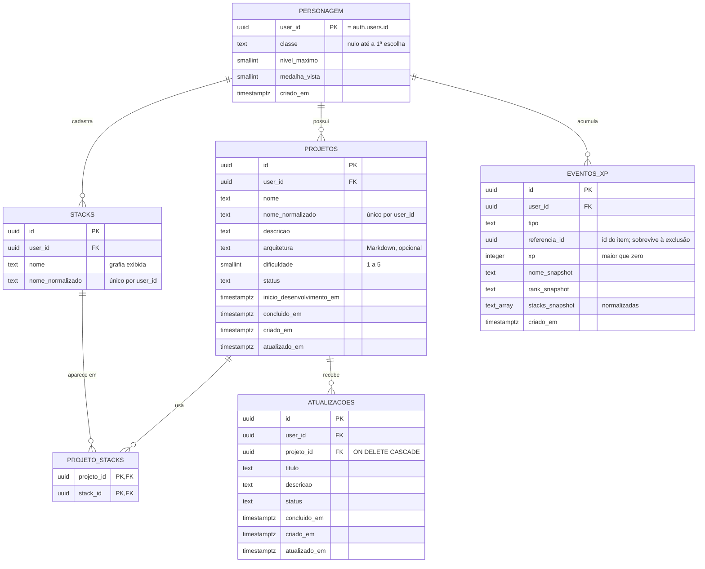

# Modelo de dados

> **Estado:** migrations versionadas em `supabase/migrations/`. Implementado: `personagem` (M1a), `projetos`, `stacks`, `projeto_stacks`, a função `salvar_missao` e o trigger de datas (M1b). A implementar: `atualizacoes` (M2), `eventos_xp` e a função `concluir_item` (M3).
>
> Modelo **transacional normalizado (3FN)**: o sistema grava e consulta registros individuais; não há camada analítica separada.

## 1. Diagrama entidade-relacionamento

## 2. Dicionário de dados

### `personagem` — grão: 1 linha por usuário
| Coluna | Tipo | Regra |
|---|---|---|
| `user_id` | `uuid` PK | = `auth.users.id`, `ON DELETE CASCADE` |
| `classe` | `text` | `CHECK` nas 8 chaves de `requisitos.md` §6; nulo até a escolha (RF-17) |
| `nivel_maximo` | `smallint` | 1–100; nunca diminui (medalhas permanentes, RN-08) |
| `medalha_vista` | `smallint` | 0–10; última medalha cuja animação já tocou |
| `criado_em` | `timestamptz` | `default now()` |

**Privilégios** (migration `criar_personagem`): `authenticated` lê a linha, cria só com `user_id` (o resto vem dos defaults) e altera só `classe` e `medalha_vista`. `nivel_maximo` fica fora do `UPDATE`: quem grava esse campo é a função de XP do M3, e assim ninguém sobe o próprio nível pela API. Não há `DELETE`: a linha sai com o usuário (`ON DELETE CASCADE`). `anon` não tem nenhum privilégio.

### `projetos` — grão: 1 linha por Projeto
| Coluna | Tipo | Regra |
|---|---|---|
| `id` | `uuid` PK | `gen_random_uuid()` |
| `user_id` | `uuid` FK | dono; base do RLS |
| `nome` | `text` | 3–80 caracteres |
| `nome_normalizado` | `text` | `lower(trim(nome))`; `UNIQUE (user_id, nome_normalizado)` |
| `descricao` | `text` | 1–2.000 |
| `arquitetura` | `text` | nulo ou até 20.000 |
| `dificuldade` | `smallint` | `CHECK (dificuldade BETWEEN 1 AND 5)` |
| `status` | `text` | `CHECK (status IN ('backlog','desenvolvimento','concluido'))` |
| `inicio_desenvolvimento_em` | `timestamptz` | ingresso mais recente em Desenvolvimento (trava de 24 h) |
| `concluido_em` | `timestamptz` | preenchido só em `concluido` (`CHECK` de coerência) |
| `criado_em`, `atualizado_em` | `timestamptz` | automáticos |

**Datas de status (RN-02):** um trigger `BEFORE INSERT OR UPDATE` grava `inicio_desenvolvimento_em` ao entrar em Desenvolvimento, `concluido_em` ao entrar em Concluído (e o apaga ao sair) e `atualizado_em` em toda edição. Essas colunas ficam fora dos `GRANT`s de escrita: só o trigger as grava.

**Privilégios** (migration `criar_missoes`): `authenticated` lê e apaga as próprias Missões e cria ou altera só `nome`, `descricao`, `arquitetura`, `dificuldade` e `status`; `user_id` vem do default `auth.uid()`, nunca do cliente. `anon` não tem nenhum privilégio. Objetos novos no `public` nascem sem acesso (migration `revogar_exposicao_padrao`).

O Rank de Missão **não é coluna**: é derivado de `dificuldade` e da contagem de stacks pelo domínio. Guardá-lo criaria duas fontes da verdade.

### `stacks` — grão: 1 linha por stack distinta do usuário
| Coluna | Tipo | Regra |
|---|---|---|
| `id` | `uuid` PK | |
| `user_id` | `uuid` FK | |
| `nome` | `text` | primeira grafia cadastrada (RN-05); 1–40 caracteres |
| `nome_normalizado` | `text` | `UNIQUE (user_id, nome_normalizado)` |

Tabela própria, e não array no projeto: permite autocompletar (evita "Next.js" e "NextJS" coexistirem) e contar uso por stack.

### `projeto_stacks` — grão: 1 linha por par (Projeto, stack)
PK composta `(projeto_id, stack_id)`. Ambas as FKs com `ON DELETE CASCADE`. O RLS só aceita ligar uma Missão do usuário a uma stack do mesmo usuário.

### Função `salvar_missao`
Cria (`p_id` nulo) ou altera uma Missão, insere as stacks novas (`on conflict do nothing`, mantendo a primeira grafia) e substitui os vínculos, **numa transação** (ADR-0003). `SECURITY INVOKER`: roda com a sessão de quem chama, sob o RLS. Valida 1 a 20 stacks distintas. Erros: `23505` nome repetido · `23514` campo fora da regra · `22023` quantidade de stacks · `P0002` Missão inexistente ou de outro usuário.

### `atualizacoes` — grão: 1 linha por Atualização
| Coluna | Tipo | Regra |
|---|---|---|
| `projeto_id` | `uuid` FK | obrigatório; `ON DELETE CASCADE` (RN-04) |
| `titulo` | `text` | 3–120 |
| `descricao` | `text` | 1–5.000 |
| `status`, `concluido_em`, datas | | mesmas regras de `projetos` |

### `eventos_xp` — grão: 1 linha por evento de XP de um item
| Coluna | Tipo | Regra |
|---|---|---|
| `tipo` | `text` | `criacao_projeto` · `criacao_atualizacao` · `conclusao_projeto` · `conclusao_atualizacao` |
| `referencia_id` | `uuid` | id do Projeto ou Atualização. **Sem FK**: o evento precisa sobreviver à exclusão do item |
| `xp` | `integer` | `CHECK (xp > 0)` |
| `nome_snapshot` | `text` | nome do item no momento do evento (Registro de Missões) |
| `rank_snapshot` | `text` | Rank de Missão no momento do evento |
| `stacks_snapshot` | `text[]` | stacks normalizadas na conclusão do Projeto (Maestria) |
| — | | `UNIQUE (referencia_id, tipo)`: garante RN-06a no banco, não só na aplicação |

**Append-only:** o RLS permite `SELECT`; a escrita acontece apenas pela função `concluir_item` e pelas funções de criação e exclusão. A única remoção prevista é a revogação do XP de criação (RN-06c).

## 3. Segurança no banco

- RLS habilitado em **todas** as tabelas, com política `user_id = auth.uid()` para cada operação permitida.
- A aplicação usa a sessão do usuário (publishable key + JWT), nunca a `service_role`.
- Privilégios explícitos e por coluna (`GRANT`), porque a Data API não expõe tabelas novas automaticamente e o RLS filtra linhas, não colunas.
- Testes de banco em pgTAP (`supabase/tests/database/`, `npm run db:test`) provam que um usuário B não lê nem altera dados de um usuário A. Rodam no CI (job `banco`) a cada PR, junto com os advisors.

## 4. Consultas derivadas e grão

| Consulta | Fonte | Atenção ao grão |
|---|---|---|
| XP total | `SUM(xp)` em `eventos_xp` do usuário | Grão do evento: sem JOIN, sem risco de duplicação |
| Nível, título, Rank do Caçador | XP total + domínio | Calculado, não armazenado (exceto `nivel_maximo`) |
| Maestria | `unnest(stacks_snapshot)` em eventos `conclusao_projeto`, agrupado por stack | O XP de um Projeto é replicado para cada stack **por definição** (ver `gamificacao.md` §5). A soma entre stacks não é o XP total |
| Registro de Missões | `eventos_xp` ordenado por `criado_em` | Usa os snapshots; continua legível após exclusões |

## 5. Qualidade de dados (restrições no banco)

| Dimensão | Garantia |
|---|---|
| Validade | `CHECK` em status, dificuldade, classe, tamanhos e `xp > 0` |
| Unicidade | `UNIQUE` em nome normalizado de Projeto e stack; `UNIQUE (referencia_id, tipo)` no ledger |
| Completude | `NOT NULL` em todo campo obrigatório |
| Consistência | `CHECK` de coerência entre `status` e `concluido_em`; função atômica para status + XP |
